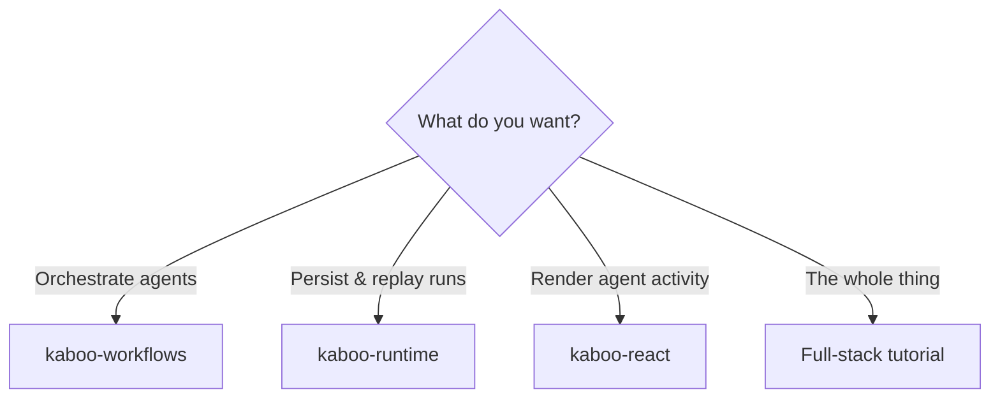
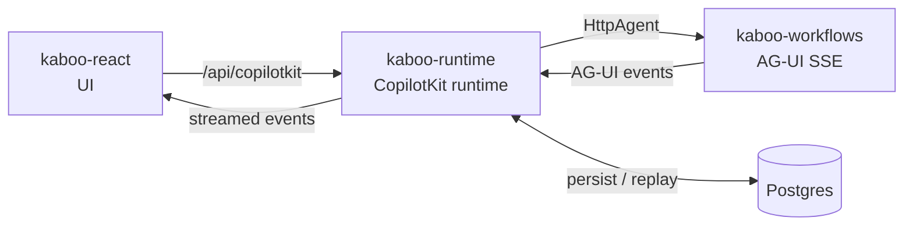

# Start here

kaboo is three libraries that snap together. Pick the path that matches what you
want to build — you can always add the others later.

## I want to orchestrate agents

Define models, agents, tools, MCP servers, and multi-agent orchestrations
(delegate / swarm / graph / parallel / nested) in **YAML**, then serve them as an
AG-UI SSE endpoint. `load()` returns plain `strands` objects, so you can also
drive agents in-process. Host backends get a first-class per-run side channel
(`forwardedProps` → `get_forwarded_props()`), authorized attachment fetching
(`attachments.base_url` / `authorization`), and — with
`create_agui_app(session_config_key=...)` — **runs that submit their own config**,
so one process serves many workflows and editing one takes effect on the next turn
without a restart.

→ [kaboo-workflows](https://gl-pgege.github.io/kaboo-workflows/) ·
[Getting started](https://gl-pgege.github.io/kaboo-workflows/getting-started/)

## I want to persist and replay runs

Drop a plugin into a **CopilotKit runtime** (NestJS or any Node framework) that
records the full event log per thread and replays it on reconnect — so a browser
refresh mid-run or post-run restores exactly what happened. Ships an
`InMemoryThreadStore` and a `PostgresThreadStore`, and records real thread
ownership (`accessPolicy.ownerOf` → `createdById`) so hosts can scope thread
lists per caller without parsing ids. Persisted state is replayed into the next
run, which is what makes conversation history server-owned and a pending
human-in-the-loop approval durable across a restart.

→ [kaboo-runtime](https://gl-pgege.github.io/kaboo-runtime/) ·
[Concepts](https://gl-pgege.github.io/kaboo-runtime/concepts/)

## I want to render agent activity

Drop-in **React** components + hooks that turn the AG-UI run stream into a live,
hierarchical activity tree with drill-down and human-in-the-loop, inside a
CopilotKit chat.

→ [kaboo-react](https://gl-pgege.github.io/kaboo-react/) ·
[Concepts](https://gl-pgege.github.io/kaboo-react/concepts/)

## I want the whole stack

Wire all three end-to-end: YAML agents → served over AG-UI → persisted in a
CopilotKit runtime → rendered in React, backed by Postgres.

→ [Full-stack tutorial](full-stack-tutorial.md)

## How they fit together

## Upgrading the stack

The libraries can be upgraded **in any order**. Each new version reads what the
older versions of the others send, and nothing a newer piece sends can be
mistaken for an approval by an older one (a denial or a skip always travels as a
cancellation). Each library's upgrade guide lists what to change in your code:
[kaboo-workflows](https://gl-pgege.github.io/kaboo-workflows/upgrading/) ·
[kaboo-runtime](https://gl-pgege.github.io/kaboo-runtime/upgrading/) ·
[kaboo-react](https://gl-pgege.github.io/kaboo-react/upgrading/).

What each feature needs, as of kaboo-workflows 0.27, kaboo-runtime 0.6 and
kaboo-react 0.10:

| Feature | Needs |
|---|---|
| Multiple-choice questions with Other, free text refused | kaboo-workflows (the card: kaboo-react) |
| Approve all, Deny with a reason, expiry that never locks the chat | kaboo-react and kaboo-workflows |
| Sending a message skips what is waiting | kaboo-react and kaboo-workflows |
| "Allow for this chat" and "Always allow" | all three: kaboo-runtime with a grant store remembers, kaboo-workflows offers and honours, kaboo-react shows |
| Tools that enforce their own approvals (`kaboo_approval`) | all three: kaboo-workflows `interrupt.tool_approvals` pauses, kaboo-runtime's `onDecision` hands the decision (with `request`) to the host for the tool's service, kaboo-react shows "Applies to …" |
| `enrich`, server-owned `kaboo_session` / `kaboo_history`, replay past aborted runs | kaboo-runtime |
| Tool annotations for `skip_read_only` | an MCP server that declares them, relayed by localcore-gateway or AgentCore Gateway |

